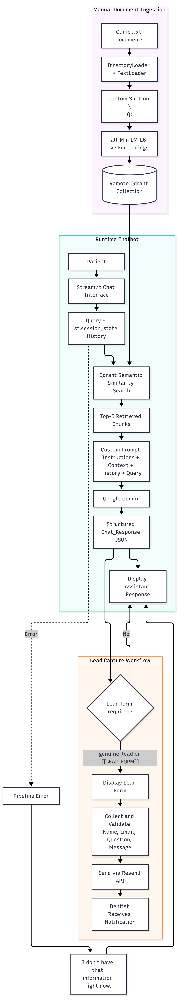

# Dental-chatbot-demo
AI Assistant which Capture Leads and Automate Patients Responses 24/7

## Problem Statement

Small dental clinics and solo practitioners often struggle to manage repetitive patient inquiries while maintaining consistent communication outside regular clinic hours.

Patients frequently ask questions about dental services, treatments, pricing, and appointments. Handling these repetitive inquiries manually consumes valuable staff time and creates additional operational overhead.

The problem becomes more significant when potential patients reach out after business hours or when clinic staff are unavailable. Without timely responses or a structured lead-capture process, clinics risk losing potential patients and business opportunities.

Additionally, when an AI assistant cannot confidently answer a question using its available knowledge base, there needs to be a fallback mechanism to prevent inaccurate responses and allow human intervention.

This project explores how Retrieval-Augmented Generation (RAG) and conversational AI can address these challenges through:

- **24/7 Patient Assistance:** Answering common patient inquiries using clinic-specific information.
- **Intelligent Fallback Handling:** Identifying questions the assistant cannot answer reliably and escalating them for human intervention.
- **Buying-Intent Detection:** Recognizing potential patients interested in treatments, pricing, or appointments.
- **Automated Lead Capture:** Capturing potential patient information and notifying the clinic through email.

**Target Users:** Solo dentists and small dental clinics looking to improve patient communication, reduce repetitive administrative work, and minimize missed business opportunities.

## Solution

To address these challenges, this project implements a web-based AI assistant
for small dental clinics, combining Retrieval-Augmented Generation (RAG)
with automated lead-capture and email notification workflows.

The assistant uses clinic-specific documents as its knowledge source,
allowing patients to ask questions about treatments, pricing, clinic policies,
and other relevant information through a conversational interface.

Instead of relying entirely on the LLM's parametric knowledge, the system
retrieves relevant information from the clinic's knowledge base and uses
that context to generate grounded responses.

### Key Features

- **Knowledge-Based Patient Assistance:** Answers patient inquiries using
  relevant information retrieved from clinic-specific documents.

- **Grounded Responses:** Uses retrieved document context to generate
  responses aligned with the clinic's available information.

- **LLM-Based Buying-Intent Detection:** Uses the LLM to identify potential
  patients expressing interest in treatments, pricing, or appointments within classification rules.

- **Automated Lead Capture:** Collects patient details, including name,
  email, and inquiry, when a potential lead is identified.

- **Intelligent Fallback Handling:** When sufficient information cannot be
  retrieved to answer a question, the assistant provides a fallback response
  and captures the inquiry for human follow-up.

- **Email Notifications:** Sends captured lead information and unanswered
  inquiries to the dentist through an automated email workflow.

### How It Works

1. A patient interacts with the assistant through the web-based chat interface.
2. The system retrieves relevant information from the clinic's document-based
   knowledge base.
3. The LLM generates a response grounded in the retrieved context.
4. The LLM identifies whether the patient's message expresses buying intent.
5. When appropriate, the system collects patient details.
6. If the assistant cannot answer reliably, it triggers the fallback workflow.
7. Captured leads and unanswered inquiries are sent to the dentist through
   email notifications.

The primary objective is to demonstrate a practical implementation of
Retrieval-Augmented Generation, focusing on reliable retrieval, grounded
responses, and integration with real-world business workflows.


## Architecture

### Technology Stack

| Component | Technology | Purpose |
|---|---|---|
| Frontend & Application Runtime | Streamlit | Web-based chat interface and application runtime |
| Backend Logic | Python | Application logic and workflow orchestration |
| LLM | Google Gemini | Context-aware response generation and buying-intent detection |
| Embedding Model | all-MiniLM-L6-v2 | Converts text into vector embeddings |
| Vector Database | Qdrant | Stores and retrieves document embeddings |
| Orchestration | LangChain + Custom Python | Document processing, retrieval, and application workflows |
| Document Loading | LangChain DirectoryLoader, TextLoader | Loads documents from the knowledge base |
| Email Service | Resend | Sends lead and fallback notifications to the dentist |

## AI Dental Clinic Assistant
<p align="center">
  
</p>


### 1. Document Ingestion Pipeline

The ingestion pipeline transforms clinic-specific text documents into
searchable vector representations stored in Qdrant.

**Ingestion Workflow:**

1. **Document Loading:** LangChain's `DirectoryLoader` and `TextLoader`
   load `.txt` files from the configured data directory.

2. **Custom Chunking:** Instead of using a standard LangChain text splitter,
   the application uses a custom parsing strategy that splits documents
   using the `\nQ:` marker.

3. **Embedding Generation:** Each resulting text chunk is converted into
   a vector embedding using the `all-MiniLM-L6-v2` model.

4. **Vector Storage:** The generated embeddings and their corresponding
   text chunks are stored in a Qdrant collection using `QdrantVectorStore`.

**Ingestion Execution:**

The ingestion pipeline is executed manually through `run.py`.

- Run once during initial setup.
- Re-run whenever clinic documents are updated.
- The Streamlit application does not automatically execute ingestion
  during startup.
- Existing Qdrant collections are deleted and recreated during ingestion.

This separation keeps document processing independent from the
patient-facing application runtime.


### 2. Retrieval & Generation Pipeline

When a patient submits a question, the system retrieves relevant information
from the Qdrant vector database and uses it as context for LLM response
generation.

**Retrieval Workflow:**

1. **Patient Query:** The patient's message is received through the
   Streamlit chat interface.

2. **Semantic Retrieval:** The query is embedded using the configured
   embedding model and searched against the Qdrant collection using
   LangChain's `QdrantVectorStore.similarity_search_with_score()`.

3. **Top-K Retrieval:** The system retrieves the five nearest document
   chunks (`Top-K = 5`), configured in `setting.py`.

4. **Retrieval Validation:** Retrieved chunks and their similarity scores
   are validated in the retrieval layer before being returned.

5. **Context Construction:** The application constructs a custom prompt
   containing:
   - Assistant instructions
   - Retrieved document context
   - Conversation history
   - Current patient query

6. **Response Generation:** The constructed prompt is passed to Google
   Gemini, which generates a response using the supplied context.

**Retrieval Configuration:**

| Parameter | Configuration |
|---|---|
| Vector Database | Qdrant |
| Search Method | Semantic Similarity Search |
| Retrieval Implementation | `similarity_search_with_score()` |
| Top-K | 5 |
| Similarity Threshold | Not configured |
| Reranking | Not implemented |
| Generation Model | Google Gemini |

**Current Retrieval Trade-offs:**

The system retrieves the five nearest chunks without applying a minimum
similarity-score threshold. Retrieved chunks are not reranked before
being passed to Gemini.

This keeps the retrieval pipeline relatively simple while providing a
baseline implementation for evaluating semantic retrieval and
context-grounded generation.


### 3. LLM Response & Intent Classification

The application uses Google Gemini for both response generation and
patient-intent classification within a single LLM call.

Instead of making separate LLM requests for answering questions and
classifying user intent, the system uses structured output matching
the `Chat_Response` Pydantic schema.

**Expected Response Structure:**

{
  "answer": "...",
  "category": "genuine_lead"
}

The supported intent categories are:

| Category | Description |
|---|---|
| `genuine_lead` | Patient expresses potential buying or treatment intent |
| `information_education` | Patient seeks general dental information |
| `unrelated` | Message is unrelated to the clinic's services |

The application uses the returned category to determine whether
additional lead-capture actions should be presented.

When the category is `genuine_lead`, the application displays a lead
form after generating the response.

### 4. Intelligent Fallback Handling

The system uses an LLM-guided fallback mechanism when retrieved context
is missing or insufficient to answer a patient's question.

Gemini is instructed to include a predefined marker in its response:

`For further details on assistance, please contact the team [[LEAD_FORM]]`

The application inspects the generated response for the `[[LEAD_FORM]]`
marker to identify fallback scenarios and trigger the lead-capture form.

**Fallback Behavior:**

- The LLM is instructed to use the fallback marker when relevant
  information is unavailable or incomplete.
- The application detects the marker in the generated response.
- Detection of the marker triggers the lead-capture form.
- A separate predefined fallback message is used when the application
  encounters a pipeline exception:

  `I don't have that information right now.`

**Important:** The exception fallback does not automatically trigger
lead collection. Lead capture is triggered by the `[[LEAD_FORM]]`
marker or the `genuine_lead` response category.

### 5. Lead Capture Workflow

When a patient expresses genuine buying intent or encounters an
LLM-triggered fallback, the application can display a lead-capture form.

The form collects:

- Patient name
- Email address
- Original question
- Optional additional message

Lead information is collected through the Streamlit UI rather than
through conversational data extraction.

Submitted information is validated using the `emailform` Pydantic
model defined in `schemas.py`.

### 6. Email Notification Workflow

After the patient submits the lead form, the application uses the
Resend API to send an email notification to the dentist.

The notification contains:

- Patient name
- Patient email
- Original question
- Optional additional message

The same email notification mechanism handles both buying-intent
leads and unanswered questions submitted through the fallback workflow.

**Current Implementation Note:**

A SQLite `LEADS` table is initialized in the application, but the
current notification workflow does not insert submitted lead records
into that table. Lead information is currently sent directly through
email.


### 7. Application Runtime & Conversation Management

The application uses Streamlit's session-state mechanism to maintain
conversation history during an active user session.

**Conversation Management:**

- Conversation messages are maintained in `st.session_state.messages`.
- Chat history is stored in application memory rather than a database.
- Each Streamlit user session maintains its own conversation state.
- Conversations are isolated between user sessions.
- Conversation history is not persisted across browser sessions.
- Refreshing or disconnecting a Streamlit session generally resets
  the conversation.

This provides lightweight session-level conversation management
without introducing a separate conversation-storage layer.

### 8. Infrastructure & Model Configuration

| Component | Configuration |
|---|---|
| Vector Database | Qdrant Cloud |
| Embedding Model | `all-MiniLM-L6-v2` |
| LLM Provider | Google Gemini |
| Gemini Model Identifier | `models/gemini-3.6-flash` |
| Conversation Storage | Streamlit `st.session_state` |
| Lead Notification | Resend API |


### Repository Structure

```text
Dental-Demo-Chatbot/
│
├── app.py                      # Streamlit application and chat interface
├── requirements.txt            # Python dependencies
│
├── config/
│   ├── setting.py              # Application and model configuration
│   ├── logger.py               # Logging configuration
│   
│
├── core/
│   ├── pipeline.py             # Main RAG pipeline orchestration
│   ├── retrieval.py            # Qdrant semantic retrieval
│   ├── generation.py           # Gemini response generation
│   ├── data_fetcher.py         # Data fetching utilities
│   
│
├── injestion/
│   ├── loads.py                # Document loading
│   ├── parse.py                # Document parsing and custom chunking
│   ├── index.py                # Embedding generation and Qdrant indexing
│   └── run.py                  # Manual ingestion pipeline execution
│
├── leads/
│   ├── database.py             # SQLite database initialization
│   └── notifier.py             # Resend email notification workflow
│
├── model/
│   └── schemas.py              # Pydantic response and lead schemas
│
├── tests/
│   ├── generation_test.py      # Generation-related tests
│   ├── llm_test.py             # LLM-related tests
│   └── retriever_test.py       # Retrieval-related tests
│
├── evals/                      # Evaluation resources
```

aha an## Getting Started

Follow these instructions to set up and run the project locally.

### Prerequisites

- Python installed
- Google Gemini API key
- Qdrant Cloud account and API credentials
- Resend API key
- Verified sender email/domain configured in Resend

### 1. Clone the Repository

```bash
git clone <repository-url>
cd Dental-Demo-Chatbot
```

### 2. Create a Virtual Environment
Windows (PowerShell):
```powershell
python -m venv venv
.\venv\Scripts\Activate.ps1
```

### 3. Install Dependencies

```bash
pip install -r requirements.txt
```

### 4. Configure Environment Variables
Create a .env file in the project root directory:

env

#### Google Gemini
  - GEMINI_API_KEY=your_gemini_api_key

#### Qdrant Cloud
  - QDRANT_URL=your_qdrant_url
  - QDRANT_API_KEY=your_qdrant_api_key
  - QDRANT_COLLECTION_NAME=dental_collection

#### Email Notifications
  - CLIENT_EMAIL=dentist@example.com
  - RESEND_API_KEY=your_resend_api_key

#### Optional Configuration
  - EMBEDDING_MODEL=all-MiniLM-L6-v2
  - GEMINI_MODEL=models/gemini-3.6-flash
  - TOP_K=5
These settings are loaded through config/setting.py.

### 5. Add Clinic Knowledge Documents
Place your clinic knowledge-base documents inside the data/ directory.

Supported format: .txt

Documents should follow the question-based structure expected by the
custom parser, which splits content using the \nQ: marker.

Example:
Q: What dental services does the clinic offer?

The clinic offers dental cleaning, teeth whitening,
dental implants, and general consultations.

Q: What are the clinic operating hours?

The clinic operates from 9 AM to 5 PM, Monday through Saturday.

Q: How much does teeth whitening cost?

The cost of teeth whitening depends on the treatment plan.
Contact the clinic for further details.

### 6. Run Document Ingestion
Execute the ingestion pipeline:
```powershell
python -m injestion.run
```

#### This process:

- Loads .txt documents from the configured data directory.
- Parses and splits documents using the custom question-based strategy.
- Generates embeddings using all-MiniLM-L6-v2.
- Stores document chunks and embeddings in Qdrant Cloud.

#### Important:

- Run ingestion once during initial setup.
- Re-run ingestion whenever clinic documents are updated.
- The existing Qdrant collection is deleted and recreated during ingestion.
- The Streamlit application does not automatically execute ingestion.

### 7. Start the Application
   
Launch the Streamlit application:
```powershell
streamlit run app.py
```

Open the local URL displayed in your terminal.

By default:

http://localhost:8501

The application initializes its SQLite database at:

data/demo.db

You can now interact with the dental AI assistant through the web-based
chat interface.

## Step 04 review

A few implementation details are particularly important:

- Ingestion and application startup are separate operations.
- Updating clinic documents requires re-running ingestion.
- Re-ingestion deletes and recreates the existing Qdrant collection, so it is a destructive replacement rather than incremental indexing.
- SQLite initialization does not mean submitted leads are currently persisted.

One recommendation: Add `.env`, `venv/`, and sensitive local files to `.gitignore` before publishing the repository.

---


## Limitations

Although the system demonstrates a functional RAG-based patient assistance
workflow, several limitations remain that could affect scalability,
reliability, and production readiness.

### 1. Retrieval Quality

The current retrieval pipeline uses semantic similarity search with
a fixed Top-5 configuration.

- No similarity-score threshold is implemented to filter potentially
  irrelevant chunks.
- No reranking mechanism is used to improve retrieval relevance.
- Retrieval quality may decrease as the knowledge base grows.

Further improvements could include hybrid search, similarity-based
filtering, and reranking.

### 2. Limited Document Support

The document ingestion pipeline currently supports only `.txt` files.

Additionally, the custom parser expects documents to follow a
question-based structure using the `Q:` marker.

This makes the ingestion process restrictive when working with
unstructured documents or other formats such as PDF and DOCX.

### 3. Manual Document Ingestion

Document ingestion is not automated.

Developers must manually execute the ingestion script whenever
clinic documents are added, updated, or removed.

The current ingestion process also deletes and recreates the existing
Qdrant collection rather than performing incremental updates.

### 4. Temporary Conversation History

Conversation history is maintained using Streamlit's `st.session_state`.

- Conversations are isolated between user sessions.
- Chat history is not persisted in a database.
- Conversation history is generally lost when a session resets
  or disconnects.

Persistent conversation storage would be required to support
long-term conversation tracking and continuity.

### 5. LLM Dependency

Response generation, buying-intent classification, and fallback
behavior depend heavily on Gemini's output.

Incorrect classification or unsupported generated responses may
affect the reliability of the assistant.

The system therefore requires further evaluation and validation
before being considered suitable for production use.

### 6. API Usage Constraints

The application depends on Gemini API availability and usage limits.

The available API quota and request limits depend on the configured
Gemini service tier, which can restrict the number of requests
the application can handle.

### 7. Missing Production Features

Some capabilities commonly expected in production conversational
AI systems are not currently implemented:

- **Rate Limiting:** No request-level rate-limiting mechanism
  is currently implemented.
- **Streaming Responses:** Assistant responses are generated
  without token-by-token streaming.

These features would improve resource management and the
overall conversational experience.

### 8. Limited Scale

The current implementation is designed and tested around a
small clinic knowledge base.

Its retrieval performance and operational behavior have not
yet been established for large document collections or
high-concurrency workloads.


